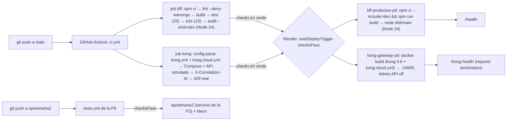
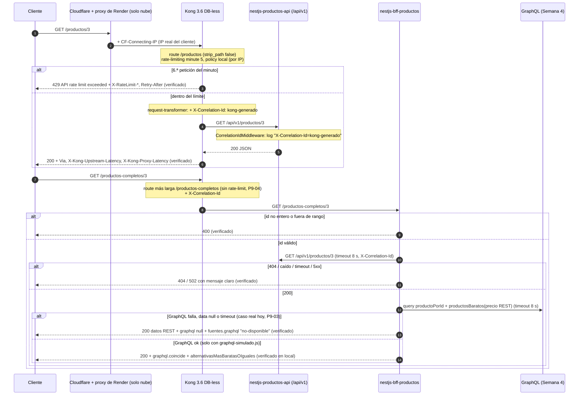

# Auditoría final - Práctica 9: Kong Gateway DB-less delante de microservicios NestJS, rate-limiting, X-Correlation-Id, Aggregator/BFF y despliegue en Render

## 1. Datos del proyecto

| Campo | Valor |
|---|---|
| Materia | Integración de Sistemas (PUCE) · Semana 8 · Kong Gateway enrutando microservicios NestJS |
| Autor | Anthony Rosero (trabajo individual) |
| Repositorios | https://github.com/ajrm18/kong-gateway-practica-9 (nuevo, público, rama `main`, sin protección, sin licencia) y https://github.com/ajrm18/apisemana2 (API de Productos, solo se agregó el log de correlación) |
| Carpeta auditada | Clones nuevos en `C:\Users\HP\Downloads\1\tmp-auditoria-p9\p9` y `...\api` (borrados al terminar). Carpetas de trabajo: `C:\Users\HP\Downloads\1\kong-gateway-practica-9` y `C:\Users\HP\Downloads\1\nestjs-productos-api` |
| Estado auditado | `kong-gateway-practica-9`: `HEAD = 82f4df7` (`82f4df739aaf0d6e09d823389db45c26efe57b04`, "docs: evidencia en la nube (429 real en Render) y links publicos"), 12 commits, 46 archivos versionados, CI `43769225079` en verde. `apisemana2`: `HEAD = aab0a63` (`aab0a63173b76e59132d46a37bf7fd94383a513f`, "feat: log de X-Correlation-Id para Kong (Semana 8)"), CI `43758923525` en verde |
| Servicios publicados | Kong: https://kong-gateway-p9.onrender.com (`/productos`, `/productos/3`, `/productos-completos/3`, `/kong-health`) · BFF: https://bff-productos-p9.onrender.com/health · API: https://apisemana2.onrender.com/api/v1/productos · Swagger: https://apisemana2.onrender.com/api/docs (Render Free, Oregon; Kong y BFF desde el Blueprint `render.yaml`) |
| Dependencias externas | API GraphQL https://nestjs-productos-graphql-tgv7.onrender.com/graphql (repo `ajrm18/nestjs-productos-graphql`, no modificado). PostgreSQL: local `pg-productos` (5433, no se tocó salvo lo indicado en 2.2); auditoría `pg-auditoria-p9` (127.0.0.1:5442, borrado); nube Neon (proyecto de la P8, URL solo en la variable `DATABASE_URL` de Render) |
| Fecha de la auditoría | 15 de noviembre de 2026 (17:26 a 17:55, UTC-5) |
| Entorno | Windows 10, Node.js 26.1.0, npm 11.13.0, Docker 29.9.2 (Compose v5.6.1), Kong 3.6.1 (`kong:3.6`); CI: `ubuntu-24.04` con Node 24. BFF: NestJS 12 (`@nestjs/axios` 12.0.2, `@nestjs/config` 12.1.1), axios 1.21.1, helmet 8.3.0, Jest 30.5.2, ts-jest 29.4.15, TypeScript 6.0, oxlint 1.58+. API: la misma pila de la P8 (TypeORM 1.1.1, `pg` 8.23.0) |

## 2. Alcance y método

### 2.1 Objeto de la auditoría

Se auditó el **último commit publicado** de los dos repositorios, sobre **clones nuevos** y no sobre las carpetas de trabajo. Render tiene desplegados esos mismos commits: Kong y el BFF desde el Blueprint, con `autoDeployTrigger: checksPass`, y la API desde el servicio `apisemana2` de la P8. Se revisaron el gateway (`kong.yml`, `kong.cloud.yml`, `docker-compose.yml`, `Dockerfile`), el BFF `nestjs-bff-productos`, el middleware nuevo de la API, el CI, el Blueprint, los scripts, las evidencias y la documentación.

### 2.2 Garantía de no modificación

- Todos los comandos (`npm ci`, lint, build, pruebas, `npm audit`, `kong config parse`, scripts y sondas) se ejecutaron en los clones. No se editó ningún archivo de los clones. Los scripts de prueba (`local.sh`, `local2.sh`) y los logs se escribieron fuera de ellos, en `tmp-auditoria-p9`.
- Durante la auditoría no se hicieron commits ni push, y no se cambió la configuración de Render ni de Neon. En la nube solo se hicieron GET.
- Infraestructura propia de la auditoría: Postgres `pg-auditoria-p9` (127.0.0.1:5442, detenido y arrancado a propósito para la prueba de base caída) y Kong `kong-auditoria-p9` (`docker run` con el `kong.yml` del clon montado, puertos 18000 y 127.0.0.1:18001). Los dos se borraron al terminar. El Kong de desarrollo (`kong-gateway`) se detuvo, sin borrarlo, para liberar memoria.
- **Incidencia, corregida:** en la primera corrida local, el puerto 3000 seguía ocupado por un proceso `node` huérfano de la API de desarrollo (PID 16924, base `pg-productos`), que había quedado vivo tras detener `npm run start:dev`. La API del clon no pudo arrancar (`EADDRINUSE`, ver P9-20) y dos `POST` de prueba ("Producto auditoria" id 20 y "Barato auditoria" id 21) **cayeron en `pg-productos`**. Se borraron con `DELETE ... WHERE id IN (20,21) AND nombre IN (...)`, y la tabla quedó con los 6 productos originales (ids 1, 3, 4, 5, 6 y 7). Se terminaron los procesos huérfanos (PID 16924 y el BFF PID 10088) y las pruebas afectadas se repitieron con la API del clon y su base (`local2.txt`). Los resultados de esa primera corrida que dependían de la API (correlación, REST caído y base caída) se descartaron.

### 2.3 Actividades

| # | Actividad | Tipo |
|---|---|---|
| 1 | Clones limpios de los dos repositorios en `Downloads\1\tmp-auditoria-p9`; `npm ci` en los dos; comprobación de que las dependencias del BFF se resuelven dentro del clon | Ejecutado |
| 2 | BFF: `npm run lint`, `npm run build`, `npm test`, `npm run test:e2e`, `npm run test:cov`, `npm audit` y `npm audit --omit=dev` | Ejecutado |
| 3 | API: lint, build, `npm test`, `npm run test:e2e -- --runInBand` (Postgres temporal), `npm audit` | Ejecutado |
| 4 | `kong config parse` de `kong.yml` y `kong.cloud.yml` del clon | Ejecutado |
| 5 | Kong temporal + API y BFF del clon: proxy, BFF vía Kong, ids inválidos, prefijos de route, `X-Correlation-Id`, rate-limit con el script del clon, reinicio (`policy: local`), base caída, REST caído, BFF caído | Ejecutado (local) |
| 6 | Nube: health de los tres servicios, `/productos`, `/productos/1`, `/productos/3`, `/productos-completos/{1,3,abc}`, Admin API, script de rate-limit desde el clon, falsificación de `X-Forwarded-For`, bypass directo a la API y al BFF | Ejecutado (Render) |
| 7 | Diagnóstico de la IP del cliente en Render (route temporal `/kong-eco`, antes de la auditoría) | Ejecutado; evidencia en `docs/evidencia/nube-diagnostico-ip.txt` |
| 8 | Secretos en el árbol y en `git log -p --all` de los dos repositorios; archivos versionados indebidos | Ejecutado |
| 9 | GitHub: ejecuciones del CI, protección de `main`, visibilidad, licencia | Ejecutado (API de GitHub) |
| 10 | Revisión de código: servicio y controlador del BFF, configuración, middleware de la API, YAML de Kong, Blueprint, CI y scripts | Revisión manual |

Evidencias: los clones, los scripts y los logs temporales se borraron al terminar. Las salidas relevantes están transcritas en las secciones 3 y 5. Evidencias permanentes en el repositorio: `docs/evidencia/paso0.txt` … `paso7-bff.txt`, `latencia-crudo.txt`, `nube.txt` y `nube-diagnostico-ip.txt`.

### 2.4 No aplica o no confirmado

- **Panel de Render:** no se vio, y no hay clave de la API de Render en esta sesión. Que los servicios del Blueprint usan `autoDeployTrigger: checksPass` se deduce de `render.yaml` y de que cada push en verde produjo un redeploy. No se pudo leer en el panel.
- **Que `apisemana2` en Render corra el commit `aab0a63`:** sin acceso a los logs de Render, no se pudo ver la línea `[CorrelationId]` en producción. Sí se confirmó que el BFF de la nube recibe y devuelve `correlationId: "kong-generado"`.
- **Arranque en frío:** no se midió en la auditoría (los servicios estaban despiertos). Antes de la auditoría, el primer `GET /productos/3` a través de la imagen de Kong de nube tardó 31,6 s de upstream (`X-Kong-Upstream-Latency: 31642`) y el GraphQL tardó 34 s.
- **El `curl` de Git Bash no completa el handshake TLS** con hosts HTTPS en este equipo (`exit=35`, inspección de Kaspersky, ya vista en P6-P8), y `curl.exe` de Windows falla con `CRYPT_E_NO_REVOCATION_CHECK`. Las pruebas de nube se hicieron con `curl.exe --ssl-no-revoke` (la validación del certificado sigue activa). El script bash de rate-limit solo se ejecutó en local y en el CI (Linux).
- **Varias réplicas de Kong:** no se pueden probar en Render Free (una sola instancia). El comportamiento de `policy: local` con réplicas se deduce de la documentación de Kong.
- La guía de la Semana 8 se evaluó con el texto que entregó el estudiante en las instrucciones de la práctica.

## 3. Resumen por severidad

| Severidad | Cantidad | Hallazgos |
|---|---|---|
| Crítica | 0 | - |
| Alta | 0 | - |
| Media | 4 | P9-01 a P9-04 |
| Baja | 10 | P9-05 a P9-14 (P9-13 es de CI/CD) |
| Informativa | 7 | P9-15 a P9-21 |

Resultado de los comandos (Ejecutado, clones `82f4df7` y `aab0a63`):

| Comando | Resultado | Observación |
|---|---|---|
| BFF `npm ci` | OK | Las 9 dependencias de `dependencies` se resuelven dentro de `p9/nestjs-bff-productos/node_modules` |
| BFF `npm run lint` (`oxlint --type-aware --deny-warnings src/ test/`) | OK | Código 0, sin avisos |
| BFF `npm run build` | OK | `dist/main.js` y `dist/productos-completos/*` |
| BFF `npm test` | OK | 3 suites, **25 pruebas** (servicio con `HttpService` simulado: ok, REST 404, caído, timeout, 500, formato inválido, GraphQL caído, con errores y timeout; controlador: ids inválidos; configuración) |
| BFF `npm run test:e2e` | OK | **10 pruebas** con la app Nest completa y `HttpService` simulado (200, 400 ×5, 404, 502, GraphQL caído, `/health` con helmet) |
| BFF `npm run test:cov` | OK | 81,13 % de líneas y 90,1 % de ramas en las unitarias; umbral `lines: 80, branches: 70` → P9-14 |
| BFF `npm audit --omit=dev` | OK | 0 vulnerabilidades |
| BFF `npm audit` | **FALLA** (código 1) | 20 (4 bajas, 16 moderadas), todas en la cadena de desarrollo de Jest (`glob`, `minimatch`, `deepmerge`) → P9-14 |
| API `npm ci`, lint, build | OK | Igual que en la P8 |
| API `npm test` | OK | 3 suites, **25 pruebas** (23 de la P8 + 2 nuevas de `CorrelationIdMiddleware`) |
| API `npm run test:e2e -- --runInBand` (`pg-auditoria-p9`) | OK | **13 pruebas** |
| API `npm audit --omit=dev` / `npm audit` | OK / **FALLA** | 0 / 20 (las mismas de la P8, P8-11) |
| `kong config parse /kong/kong.yml` | OK | `parse successful` (contenedor `kong-auditoria-p9`) |
| `kong config parse /kong/kong.cloud.yml` | OK | `parse successful` |
| `probar-rate-limit.sh http://localhost:18000` (clon, local) | OK | 200 ×5 y **429** en la 6.ª, `X-RateLimit-Remaining-Minute: 0`, `Retry-After: 59` |
| `GET /productos-completos/3` vía Kong (local, clon) | OK | 200, `fuentes.rest: "ok"`, `fuentes.graphql: "no-disponible"`, `correlationId: "kong-generado"` → P9-03 |
| `probar-rate-limit.ps1 -BaseUrl https://kong-gateway-p9.onrender.com` (nube, 1.ª corrida) | **FALLA** (por el entorno) | 429 ×6: todos de Cloudflare ("Just a moment…"), no de Kong, y el script dio "OK" → P9-02 |
| `probar-rate-limit.ps1` en la nube (2.ª corrida, 4 min después) | OK | 200 ×5 y **429** de Kong (`API rate limit exceeded`, `x-ratelimit-remaining-minute: 0`, `x-render-origin-server: kong/3.6.1`) |
| `GET /productos-completos/3` vía Kong (nube) | OK | 200 con datos REST; GraphQL `no-disponible` (`timeout de 8000 ms` o `HTTP 429`) → P9-03 |
| `GET /productos/1` y `/productos-completos/1` (nube) | OK con aviso | 404 en los dos: en Neon no existe el id 1 → P9-12 |
| Admin API en la nube (`/services`, `/routes`, `/status` en el puerto público) | OK | 404 `no Route matched` en los tres |
| Falsificación de `X-Forwarded-For` (nube, 6 IPs distintas) | OK | 200 ×5 y 429 en la 6.ª: no salta el límite |
| Bypass directo a `apisemana2` (nube, 6 peticiones) | **FALLA** (por diseño) | 200 ×6, sin límite → P9-01 |
| Resiliencia local (base caída, REST caído, BFF caído) | OK con avisos | Base caída: `/health` 503 y `/productos` **500** → P9-09; BFF → 502 claro; REST caído → 502 de Kong y del BFF; BFF caído → 502 de Kong |
| GitHub Actions `kong-gateway-practica-9` | OK | `43769225079` (`82f4df7`), `43768785295`, `43768495310`, `43765350780`: `success`; `43765220133` (`8039265`) falló y se corrigió (P9-15) |
| GitHub Actions `apisemana2` | OK | `43758923525` (`aab0a63`): `success` |
| `git log -p --all` y árbol (secretos) | OK | 0 credenciales en los dos repositorios; la IP pública del equipo está enmascarada en la evidencia (P9-18) |

## 4. CI/CD

### 4.1 Integración continua (`.github/workflows/ci.yml`)

| Aspecto | Estado | Evidencia | Hallazgo |
|---|---|---|---|
| Eventos | `push` y `pull_request` a `main`, `workflow_dispatch`; `concurrency` cancela ejecuciones obsoletas | `ci.yml:3-15` | - |
| Permisos | `contents: read` | `ci.yml:10-11` | Correcto |
| Job `bff` | `npm ci`, lint, build, `npm test`, `npm run test:e2e`, `npm audit --omit=dev --audit-level=high` | `ci.yml:33-39` | - |
| Job `kong` | `kong config parse` de los dos YAML con `KONG_DATABASE=off`, `bash -n` del script, API simulada, Kong con Compose, comprobación de `X-Correlation-Id` y **prueba real del 429** con `probar-rate-limit.sh` | `ci.yml:48-72` | P9-02 (el script solo mira el código) |
| Entorno | `ubuntu-24.04`, Node 24, `actions/checkout@v5`, `actions/setup-node@v5`; misma versión mayor que Render (`NODE_VERSION=24`) | `ci.yml:20`, `:30`; `render.yaml:19-20` | Previene P8-06 |
| Ejecuciones | 5 en total; la 1.ª (`8039265`) falló porque la API simulada no escuchaba al cabo de 1 s; corregida con un bucle de espera | `gh run list` | P9-15 |
| Log del 429 en el CI | `Peticion 1..5: 200`, `Peticion 6: 429`, `RESULTADO: OK` | `gh run view 43765350780 --log` | - |
| Protección de rama | `main` sin protección | `GET /branches/main → "protected": false` | P9-13 |

### 4.2 Despliegue continuo (Render)

| Aspecto | Qué se sabe | Evidencia |
|---|---|---|
| Definición | Blueprint `render.yaml` con dos web services Free en Oregon: `bff-productos-p9` (Node) y `kong-gateway-p9` (Docker). La API sigue siendo el servicio `apisemana2`, creado a mano en la P3 | `render.yaml` |
| BFF | `rootDir: nestjs-bff-productos`; `npm ci --include=dev && npm run build`; `npm run start:prod`; `healthCheckPath: /health`; `NODE_ENV=production`, `NODE_VERSION=24`, `PRODUCTOS_API_URL`, `GRAPHQL_URL`, `FUENTE_TIMEOUT_MS=8000` | `render.yaml:5-26` |
| Kong | `Dockerfile` (`FROM kong:3.6` + `COPY kong.cloud.yml /kong/kong.yml`); `KONG_DATABASE=off`, `KONG_PROXY_LISTEN=0.0.0.0:10000`, `KONG_ADMIN_LISTEN=off`, 1 worker, `KONG_MEM_CACHE_SIZE=64m`, `KONG_TRUSTED_IPS=0.0.0.0/0,::/0`, `KONG_REAL_IP_HEADER=CF-Connecting-IP`; `healthCheckPath: /kong-health` (route con `request-termination`) | `render.yaml:28-66`; `kong.cloud.yml:41-53` |
| Disparo | `autoDeployTrigger: checksPass` en los dos | `render.yaml:14`, `:37` |
| Upstreams | `read_timeout: 90000` en los dos services de `kong.cloud.yml` (cold start); **sin `tls_verify`** | `kong.cloud.yml:9`, `:28` → P9-05 |
| Historia | 1.ª versión con `KONG_REAL_IP_HEADER=X-Forwarded-For`: **sin 429 en la nube** (`remaining` siempre en 4). Diagnóstico con `/kong-eco` (`06a6167`) y corrección a `CF-Connecting-IP` (`087b0ad`), antes de la auditoría | `docs/evidencia/nube-diagnostico-ip.txt`; P9-16 |
| Arranque en frío | Render Free duerme a los 15 min; el README pide abrir los tres health antes de la demo | `README.md`; P9-08 |
| Rollback | Manual desde el panel de Render (no documentado) | Deducido |



## 5. Hallazgos

### Severidad Media

#### P9-01 - Bypass del Gateway: la API y el BFF siguen públicos en Render y el rate-limit se salta llamándolos directo

- **Archivo y línea**: `render.yaml:5-26` (BFF como web service público); servicio `apisemana2` (público desde la P3); `kong.cloud.yml:8`, `:27` (Kong apunta a las URLs públicas `*.onrender.com`)
- **Tipo de verificación**: Ejecutado (nube).
- **Evidencia** (`docs/evidencia/nube.txt`, punto 7):

```text
Directo a apisemana2, peticion 1..6 -> 200 200 200 200 200 200
$ curl.exe -s https://bff-productos-p9.onrender.com/productos-completos/3   (sin Kong: correlationId null)
{"id":3,...,"fuentes":{"rest":"ok","graphql":"no-disponible"},"fuente":"aggregator","correlationId":null,...}
```

- **Causa**: en Render Free todos los web services tienen URL pública y no hay red privada entre servicios Free; Kong llega a sus upstreams por Internet.
- **Impacto**: el límite de 5 por minuto, la trazabilidad y cualquier política futura (autenticación, CORS) solo valen para quien entra por Kong. Cualquiera que conozca `apisemana2.onrender.com` (está en el README y en Swagger) hace peticiones sin límite, y las escrituras de la API (POST/PUT/DELETE) tampoco pasan por Kong. Es la limitación de diseño más importante del despliegue, aunque la guía no pide cerrarla.
- **Recomendación**: (1) que Kong envíe un secreto compartido (`request-transformer` → `X-Gateway-Key: <secreto>` como variable de Render, no en el YAML) y que la API y el BFF rechacen con 403 lo que no lo traiga; (2) en un plan de pago, convertir la API y el BFF en *private services* de Render y apuntar Kong a sus nombres internos; (3) como mínimo, aplicar también un límite en la propia API.

#### P9-02 - El script de rate-limit da por buena cualquier respuesta 429, incluida la de Cloudflare

- **Archivo y línea**: `scripts/probar-rate-limit.sh:31` (`if [ "$ultimo" = "429" ]`); `scripts/probar-rate-limit.ps1:34` (`if ($ultimo -eq "429")`); el CI usa el mismo script (`ci.yml:72`)
- **Tipo de verificación**: Ejecutado (nube, desde el clon).
- **Evidencia**: tras muchas peticiones seguidas desde la misma IP durante la práctica, la primera corrida de la auditoría devolvió:

```text
Peticion 1: 429 ... Peticion 6: 429
RESULTADO: OK, Kong devolvio 429 en la peticion 6
GET /productos-completos/3 -> <!DOCTYPE html>...<title>Just a moment...</title>... HTTP 429   (desafío de Cloudflare)
```

  Cuatro minutos después, la misma prueba dio 200 ×5 y un 429 genuino de Kong (`"message":"API rate limit exceeded"`, `x-ratelimit-limit-minute: 5`, `x-render-origin-server: kong/3.6.1`).
- **Causa**: el script solo compara el código HTTP. No comprueba que las primeras peticiones sean 200 ni que el 429 venga de Kong.
- **Impacto**: la evidencia central de la semana puede ser un falso positivo: un 429 de Cloudflare, de Render o de cualquier proxy intermedio se reporta como "Kong devolvió 429", y el CI pasaría aunque el plugin dejara de funcionar si otra capa respondiera 429. Los falsos negativos sí los detecta (con `X-Forwarded-For`, antes de la corrección de P9-16, reportó correctamente que no hubo 429).
- **Recomendación**: dar el resultado OK solo si las peticiones 1 a N-1 son 200 y la N.ª es 429 **con** el cuerpo `API rate limit exceeded` y la cabecera `X-RateLimit-Limit-Minute: 5`. Si el 429 llega sin ellos, informar "429 de otro proxy (Cloudflare/Render)" y salir con código 2. Para la demo en la nube, no lanzar muchas pruebas seguidas desde la misma IP.
- **Estado**: **corregido tras la auditoría** en el commit `298ba53` (ver sección 12).

#### P9-03 - La API GraphQL pública no entrega datos: el reto solo se ve con `graphql: "no-disponible"` (salvo con el GraphQL simulado)

- **Archivo y línea**: `nestjs-productos-graphql/src/productos/productos.resolver.ts:6` (`const API_URL = 'https://nestjs-productos-api.onrender.com/api/v1/productos'`, repo de la Semana 4, no modificado); en este repo, `nestjs-bff-productos/src/productos-completos/productos-completos.service.ts:61-90` (degradación)
- **Tipo de verificación**: Ejecutado (local y nube).
- **Evidencia**:

```text
POST https://nestjs-productos-graphql-tgv7.onrender.com/graphql  (productoPorId + productosBaratos)
HTTP 200 en 34015 ms
{"errors":[{"message":"Request failed with status code 429","path":["productoPorId"],...},
           {"message":"Request failed with status code 429","path":["productosBaratos"],...}],"data":null}
Nube: GET /productos-completos/3 -> "graphql":null,"fuentes":{"rest":"ok","graphql":"no-disponible"},
      "avisos":["GraphQL no disponible: HTTP 429"]  /  "timeout de 8000 ms" (cold start del GraphQL)
```

- **Causa**: el resolver de la Semana 4 tiene fija la URL REST de otro despliegue (`nestjs-productos-api.onrender.com`), que hoy responde 429. GraphQL convierte esos errores en `data: null`, y a veces el cold start del GraphQL (34 s) supera el timeout de 8 s del BFF.
- **Impacto**: el BFF se comporta como debe (responde con REST y marca la fuente como no disponible, sin 500), pero `graphql.coincide` y `alternativasMasBaratasOIguales` **nunca se ven con datos reales**, ni en local ni en la nube. El camino `graphql: "ok"` solo está demostrado con las pruebas unitarias y e2e y con `scripts/graphql-simulado.js` (`paso7-bff.txt`, punto 3). Es una dependencia encadenada de dos despliegues gratuitos, como P5-16.
- **Recomendación**: en el repo de GraphQL (fuera del alcance de esta práctica), leer la URL REST de una variable (`PRODUCTOS_API_URL=https://apisemana2.onrender.com/api/v1`) y redesplegar. En la demo, explicar el estado `no-disponible` y mostrar el punto 3 de `paso7-bff.txt`.

#### P9-04 - La route `/productos-completos` no tiene rate-limit y cada petición genera dos llamadas aguas abajo

- **Archivo y línea**: `kong-gateway/kong.yml:27-41` y `kong.cloud.yml:26-39` (el service del BFF solo tiene `request-transformer`); `productos-completos.service.ts:102`, `:146` (una llamada REST y una GraphQL por petición)
- **Tipo de verificación**: Ejecutado (local: `/productos-completos/{id}` no trae cabeceras `X-RateLimit-*`, `paso7-bff.txt`, punto 6) y revisión manual.
- **Impacto**: el límite de 5 por minuto protege `/productos`, pero por `/productos-completos` se puede llamar a la API REST sin límite, y además el BFF amplifica: cada petición produce una a REST y otra a GraphQL. El BFF consulta REST directo por su URL pública, así que esas llamadas tampoco cuentan en el límite de `productos-service`. La guía solo pide el plugin en el service de productos.
- **Recomendación**: añadir `rate-limiting` también a `bff-productos-service` (o declararlo global, en la raíz de `kong.yml`) con un límite propio, y hacer que el BFF llame a REST a través de Kong (o con el secreto de P9-01).

### Severidad Baja

#### P9-05 - Kong no verifica el certificado TLS de los upstream en la nube

- **Archivo y línea**: `kong-gateway/kong.cloud.yml:6-9` y `:26-28` (services `https://` sin `tls_verify`)
- **Tipo de verificación**: Ejecutado (antes de la auditoría, con la imagen de nube en local).
- **Evidencia**: con `tls_verify: true` y `KONG_LUA_SSL_TRUSTED_CERTIFICATE=system` (y también con `tls_verify_depth: 4` y `KONG_NGINX_PROXY_PROXY_SSL_TRUSTED_CERTIFICATE=/etc/ssl/certs/ca-certificates.crt`), Kong respondía 502 y registraba `upstream SSL certificate verify error: (20:unable to get local issuer certificate)`. En cambio, `openssl s_client` dentro del mismo contenedor validaba la cadena (`issuer=Google Trust Services WE1`, `Verify return code: 0`). Se retiró `tls_verify` y se documentó en el README.
- **Causa**: en Kong 3.6 OSS, la verificación del upstream usa el almacén de la entidad `ca_certificates` del service. Sin ella, no usa la CA del sistema.
- **Impacto**: el tráfico Kong → Render va cifrado, pero sin verificar el certificado del servidor. Quien pudiera interceptar el tráfico de salida de Render (poco probable) podría suplantar la API o el BFF.
- **Recomendación**: declarar en `kong.cloud.yml` una entidad `ca_certificates` con la raíz que usa Render (hoy la cadena de Google Trust Services) y referenciarla en `ca_certificates:` de cada service, junto con `tls_verify: true` y `tls_verify_depth: 3`. Hay que actualizarla si Render cambia de CA.

#### P9-06 - `X-Correlation-Id` fijo: no correlaciona peticiones y no reemplaza el valor del cliente

- **Archivo y línea**: `kong-gateway/kong.yml:20-24` y `:37-41` (`request-transformer` → `add.headers: "X-Correlation-Id:kong-generado"`); `nestjs-productos-api/src/common/correlation-id.middleware.ts:12-13`
- **Tipo de verificación**: Ejecutado (local, clon).
- **Evidencia** (log de la API del clon):

```text
GET /api/v1/productos/20 X-Correlation-Id=kong-generado
GET /api/v1/productos/20 X-Correlation-Id=kong-generado
GET /api/v1/productos/20 X-Correlation-Id=(sin header)      <- directo al 3000
GET /api/v1/productos/20 X-Correlation-Id=cliente-abc       <- el cliente envió su propio header a Kong
```

- **Impacto**: todas las peticiones que pasan por Kong llevan el mismo valor, así que el header demuestra que la petición pasó por el gateway, pero no permite seguir una petición concreta por Kong, BFF, REST y GraphQL. Además, `add` no sobrescribe: un cliente puede meter cualquier valor (hasta 128 caracteres en el BFF) en los logs de la API y en la respuesta del BFF. Es lo que pide la guía (desviación aceptada, README "Mejora opcional").
- **Recomendación**: la mejora documentada en el README: plugin `correlation-id` con `generator: uuid` y `echo_downstream: true`. Si se quiere respetar el id del cliente, validarlo con un patrón (por ejemplo, UUID) y reemplazarlo si no cumple.

#### P9-07 - `policy: local`: el contador vive en la memoria del nodo, se reinicia con cada restart o redeploy y no se comparte entre réplicas

- **Archivo y línea**: `kong-gateway/kong.yml:15-18`, `kong.cloud.yml:16-19`
- **Tipo de verificación**: Ejecutado (local) y Deducido (réplicas).
- **Evidencia**: tras agotar el cupo (`X-RateLimit-Remaining-Minute: 0`), `docker restart kong-auditoria-p9` y una petición más → `200`, `X-RateLimit-Remaining-Minute: 4`.
- **Impacto**: en Render Free el servicio se duerme a los 15 min y se reinicia con cada deploy, así que el contador se pierde. Con varias instancias, cada una contaría por separado (límite efectivo de 5 × N). `cluster` no está disponible en DB-less (no hay base de datos); la opción para compartirlo es `policy: redis`. Dentro de un nodo, los workers sí comparten el contador (diccionario compartido `kong_rate_limiting_counters`). Con una sola instancia, para la práctica es adecuado.
- **Recomendación**: si hay réplicas, `policy: redis` con un Redis gestionado y `fault_tolerant: true`.

#### P9-08 - Kong es punto único de fallo; con cold start, la primera llamada al BFF puede dar 502

- **Archivo y línea**: `render.yaml:28-37` (una instancia Free de Kong); `render.yaml:25-26` (`FUENTE_TIMEOUT_MS=8000`); `kong.cloud.yml:9`, `:28` (`read_timeout: 90000`)
- **Tipo de verificación**: Ejecutado (local, `paso6.txt`: con Kong detenido, `curl: (7) Failed to connect`) y Deducido (nube).
- **Impacto**: si Kong cae o se duerme, nadie llega a la API ni al BFF por la entrada oficial (salvo por el bypass de P9-01). Kong espera hasta 90 s al upstream, pero el BFF solo espera 8 s a REST: si `apisemana2` está despertando (31,6 s medidos), el BFF responde 502 aunque Kong habría esperado. El README advierte que hay que despertar los servicios antes de la demo.
- **Recomendación**: abrir los tres `/health` antes de la demo (ya documentado). En producción, dos o más instancias de Kong detrás del balanceador y, en el BFF, un timeout mayor para REST que para la fuente secundaria (o un reintento).

#### P9-09 - Con la base caída, la API responde 500 genérico, también a través de Kong (persiste P8-08)

- **Archivo y línea**: `nestjs-productos-api/src/common/errores-base-datos.filter.ts:13-16` (solo captura `QueryFailedError`)
- **Tipo de verificación**: Ejecutado (clon, `docker stop pg-auditoria-p9` con la API en marcha).
- **Evidencia**:

```text
health -> {"status":"error","baseDatos":"desconectada"} HTTP 503
/productos/20 via Kong -> {"statusCode":500,"message":"Internal server error"} HTTP 500
/productos-completos/20 via Kong -> {"statusCode":502,"message":"La API REST de productos no esta disponible: HTTP 500","fuente":"rest"} HTTP 502
tras levantar la base: /productos/20 -> 404 (reconexión automática; el id 20 no existe en la base del clon)
```

- **Impacto**: el BFF traduce el 500 a un 502 claro, pero el cliente de `/productos` recibe 500 genérico en lugar de 503. Es el mismo hallazgo de la P8; esta práctica no tocó el filtro.
- **Recomendación**: la de P8-08: traducir los errores de conexión (`ECONNREFUSED`, `ETIMEDOUT`, `57P01`) a 503 en el filtro.

#### P9-10 - SSL de la API hacia Neon con `rejectUnauthorized: false` (persiste P8-09)

- **Archivo y línea**: `nestjs-productos-api/src/app.module.ts:29-32`
- **Tipo de verificación**: Revisión manual.
- **Impacto**: el mismo de P8-09. `synchronize: !produccion` (`app.module.ts:26`) sigue bien.
- **Recomendación**: `ssl: { rejectUnauthorized: true }` o delegar en `sslmode=verify-full`.

#### P9-11 - `container_name: kong-gateway` fijo: impide una segunda instancia con otro proyecto Compose; el apagado supera los 10 s

- **Archivo y línea**: `kong-gateway/docker-compose.yml:6`
- **Tipo de verificación**: Revisión manual y Ejecutado.
- **Evidencia**: para la auditoría, `docker compose -p kong-auditoria-p9 up` habría chocado con el nombre `kong-gateway` del Kong de desarrollo, así que se usó `docker run --name kong-auditoria-p9`. Con el nombre fijo tampoco se pueden ejecutar dos copias del repo (por ejemplo, dos ramas) a la vez. Además, `docker compose stop kong` terminó con `Exited (137)` (`paso6.txt`): Kong no completó su apagado en los 10 s por defecto y Docker lo mató.
- **Recomendación**: quitar `container_name` (Compose genera `<proyecto>-kong-1`) y usar siempre `docker compose exec kong ...`, que no depende del nombre. Añadir `stop_grace_period: 30s`.

#### P9-12 - `/productos/1` y `/productos-completos/1` dan 404 en la nube: en Neon no existe el id 1

- **Archivo y línea**: base Neon de `apisemana2` (ids 3, 4 y 5); `README.md` ("Links públicos" y "Hallazgos del entorno")
- **Tipo de verificación**: Ejecutado (nube).
- **Evidencia**: `GET https://kong-gateway-p9.onrender.com/productos/1` → `{"message":"Producto 1 no existe","error":"Not Found","statusCode":404}`; `/productos-completos/1` → `{"statusCode":404,"message":"El producto 1 no existe en la API REST","fuente":"rest"}`. Con el id 3 → 200 en los dos.
- **Impacto**: la guía usa `/productos/1` en todos sus ejemplos. Si el docente abre ese link en la nube verá un 404: es correcto, pero parece un fallo. En local el id 1 sí existe (`pg-productos`).
- **Recomendación**: en la demo y en los links públicos usar **`/productos/3`** y **`/productos-completos/3`** (el README ya lo hace y lo explica). Opcionalmente, recrear un producto con id 1 en Neon.

#### P9-13 - `main` sin protección: el CI no impide un push directo con fallos (CI/CD)

- **Archivo y línea**: configuración del repositorio (`GET /repos/ajrm18/kong-gateway-practica-9/branches/main` → `"protected": false`)
- **Tipo de verificación**: Ejecutado (API de GitHub).
- **Impacto**: con `checksPass`, Render no desplegó el commit `8039265` (CI en rojo), pero ese commit quedó en `main`. Es el resto de P3-07, P6-04, P7-10 y P8-07, con la misma severidad.
- **Recomendación**: regla de protección para `main` con los checks de los jobs `bff` y `kong` (opcional en un trabajo individual).

#### P9-14 - 20 vulnerabilidades en las dependencias de desarrollo (cadena de Jest) y cobertura al límite del umbral

- **Archivo y línea**: `nestjs-bff-productos/package.json` (`jest` 30.5.2, `ts-jest` 29.4.15) y el de la API
- **Tipo de verificación**: Ejecutado.
- **Evidencia**: `npm audit` → `20 vulnerabilities (4 low, 16 moderate)` en `glob`, `minimatch`, `deepmerge`, `babel-plugin-istanbul`…; `npm audit --omit=dev` → 0 en los dos proyectos. Cobertura unitaria del BFF: 81,13 % de líneas con umbral del 80 %; `app.module.ts`, `configurar-app.ts` y `health.controller.ts` tienen 0 % en las unitarias (sí los cubre la e2e, que no se mide).
- **Impacto**: no llegan a producción (el CI falla si aparece algo alto en producción, `ci.yml:39`), pero el `npm audit` completo sale en rojo, como en la P8 (P8-11). Con la cobertura al límite, un archivo nuevo sin pruebas rompe el umbral.
- **Recomendación**: no usar `npm audit fix --force` (baja Jest a la 25); actualizar `ts-jest`/Jest cuando haya versión corregida; medir también la cobertura de la e2e.

### Severidad Informativa

#### P9-15 - Los errores de la guía quedaron bien corregidos y con evidencia del antes y el después

- **Tipo de verificación**: Ejecutado.
- **Observación**:
  1. **`strip_path` + prefijo `/api/v1`**: con el YAML literal, la Admin API muestra `"strip_path":true` y la API responde `Cannot GET /` y `Cannot GET /1` (`paso3-guia-literal.txt`). Corregido con `url: …:3000/api/v1` y `strip_path: false` (`kong.yml:6`, `:12`). Mismo JSON directo y vía Kong (`paso3.txt`).
  2. **Paso 7**: `strip_path: false` en `/productos-completos` (`kong.yml:34`). El BFF no tiene ninguna URL fija: usa `PRODUCTOS_API_URL` (obligatoria con `NODE_ENV=production`, `bff.config.ts:40-43`) y `GRAPHQL_URL`, valida que sean http/https y quita la barra final. Kong elige la ruta más larga: `/productos/1` trae `X-RateLimit-*` y a `/productos-completos/1` responde el BFF (`paso7-bff.txt`, punto 6). Prefijos: `/productosXYZ` → 404 de la API; `/PRODUCTOS` → 404 de Kong.
  3. **PowerShell**: README con columnas bash y PowerShell (`curl.exe`, `1..6 | % {...}`), y scripts `.sh` y `.ps1` que reciben la URL base. El README también avisa de `MSYS_NO_PATHCONV=1` en Git Bash.
  4. **`version:`**: no existe en `docker-compose.yml` (la línea 2 lo explica).
  5. **Correlation id fijo**: implementado tal cual y documentada la alternativa con `correlation-id`, sin activarla (P9-06).
  6. **Extra, no estaba en la guía**: `kong config parse` en un `docker run` suelto intenta conectarse a PostgreSQL (`failed to retrieve PostgreSQL server_version_num`) si no se pasa `-e KONG_DATABASE=off`; el CI lo incluye (`ci.yml:48`, `:50`). La primera ejecución del CI (`8039265`) falló porque la API simulada aún no escuchaba; se corrigió con un bucle de espera (`0eb8799`).

#### P9-16 - IP real del cliente en Render: `CF-Connecting-IP` en lugar de `X-Forwarded-For`, y el riesgo de `KONG_TRUSTED_IPS=0.0.0.0/0`

- **Archivo y línea**: `render.yaml:54-62`
- **Tipo de verificación**: Ejecutado (nube; diagnóstico previo con `/kong-eco` y prueba de la auditoría).
- **Observación**: Render pasa por Cloudflare, y `X-Forwarded-For` llega como `cliente, IP de Cloudflare, 10.24.x.x`. Con `KONG_REAL_IP_HEADER=X-Forwarded-For` y `real_ip_recursive off`, Nginx tomaba la última IP (un proxy interno distinto en cada petición): `remaining` se quedaba en 4 y **nunca salía el 429**. Con `real_ip_recursive on` tomaría la primera, que controla el cliente (`X-Forwarded-For: 1.2.3.4` aparece al principio), y se podría saltar el límite cambiando el header. `CF-Connecting-IP` lo fija Cloudflare: sobrescribe `True-Client-IP` y rechaza con **403** a un cliente que envía `CF-Connecting-IP`. Tras el cambio: 429 real, y 6 peticiones con `X-Forwarded-For` distinto → 200 ×5 + 429. El riesgo de `KONG_TRUSTED_IPS=0.0.0.0/0` (confiar en el header venga de quien venga) queda acotado porque en Render el único que se conecta a Kong es el proxy de Render detrás de Cloudflare. Si Kong se desplegara sin Cloudflare delante, cualquiera podría falsificar `CF-Connecting-IP`; en ese caso, `KONG_TRUSTED_IPS` debería limitarse a los rangos del proxy.

#### P9-17 - Admin API: solo en `127.0.0.1` en local y apagada en la nube

- **Tipo de verificación**: Ejecutado.
- **Observación**: local: `"127.0.0.1:8001:8001"` (`docker-compose.yml:21`); en el contenedor de auditoría, `docker port` → `8001/tcp -> 127.0.0.1:18001`, con el proxy en `0.0.0.0`. Nube: `KONG_ADMIN_LISTEN=off` (`render.yaml:48-49`); `/services`, `/routes` y `/status` en el puerto público → 404 `no Route matched`. En la imagen de nube no escucha nada en el 8001.

#### P9-18 - Secretos: no se encontraron

- **Tipo de verificación**: Ejecutado.
- **Evidencia**: `git log -p --all` de los dos repositorios, sin URLs `postgresql://` con credenciales reales, hosts de Neon, `rnd_`, `ghp_`, `gho_`, `github_pat_` ni claves privadas. El `.gitignore` excluye `node_modules`, `dist`, `coverage`, `.env`, `*.log` y `*.tsbuildinfo`; `git ls-files` no contiene ninguno (46 archivos). El BFF y Kong no necesitan secretos. La IP pública del equipo de pruebas está enmascarada (`157.100.x.x`) en `nube-diagnostico-ip.txt`.

#### P9-19 - Orden REST → GraphQL y `Promise.allSettled` con una sola promesa

- **Archivo y línea**: `productos-completos.service.ts:55-90`
- **Tipo de verificación**: Revisión manual.
- **Observación**: la query GraphQL necesita el precio que devuelve REST (`productosBaratos(precioMaximo: <precio REST>)`), así que no puede ir en paralelo con REST. Lo que sí va en paralelo son los dos campos de la única query, que el servidor GraphQL resuelve a la vez. `Promise.allSettled([consultarGraphql(...)])` envuelve una sola promesa: funciona y expresa "fuente secundaria que nunca rompe la respuesta", pero un `try/catch` sería más directo. Está documentado en el README ("Desviaciones y decisiones"). El BFF valida la forma de las respuestas REST y GraphQL (`esProducto`), no devuelve pilas y registra cada fallo en una línea con el `correlationId` (previene P5-08).

#### P9-20 - Entorno Windows: Kaspersky, rutas de Git Bash y procesos `node` huérfanos

- **Tipo de verificación**: Ejecutado.
- **Observación**: (1) Kaspersky impide el TLS del `curl` de Git Bash (`exit=35`) y la comprobación de revocación de `curl.exe` (`CRYPT_E_NO_REVOCATION_CHECK`); el `.ps1` acepta `-SslNoRevoke` (opcional). (2) Git Bash convierte `/kong/kong.yml` en `C:/Program Files/Git/kong/kong.yml`; el README lo explica (`MSYS_NO_PATHCONV=1`). (3) Al detener `npm run start:dev` (o cuando Claude Code mata el proceso por falta de memoria), el `node dist/main` hijo puede quedar vivo ocupando el 3000; eso causó la incidencia de la sección 2.2. Ante un puerto ocupado, la API y el BFF responden bien: una línea (`No se pudo arrancar la API: listen EADDRINUSE`) y código 1 (previene R13). Antes de una demo conviene revisar `netstat -ano | findstr :3000`.

#### P9-21 - Repositorio sin licencia

- **Tipo de verificación**: Ejecutado (`license: null`).
- **Observación**: el `package.json` del BFF declara `UNLICENSED` y no hay `LICENSE`. Es irrelevante para la entrega (igual que P6-08, P7-16 y P8-19).

## 6. Qué se comprobó sin encontrar problemas

- **Kong DB-less**: `KONG_DATABASE: "off"` y `KONG_DECLARATIVE_CONFIG`; los dos YAML pasan `kong config parse` en local, en el clon y en el CI; `/status` responde con `configuration_hash` (`paso1.txt`).
- **Proxy**: mismo JSON directo y vía Kong, con `Via: kong/3.6.1`, `X-Kong-Upstream-Latency` y `X-Kong-Proxy-Latency` (`paso3.txt`); en la nube con `x-render-origin-server: kong/3.6.1`.
- **Rate-limiting**: 200 ×5 y 429 en la 6.ª con `API rate limit exceeded`, `X-RateLimit-Limit-Minute: 5`, `X-RateLimit-Remaining-Minute: 0`, `RateLimit-Reset` y `Retry-After`, en local (bash y PowerShell), en el clon, en GitHub Actions y en Render. Cambiar `X-Forwarded-For` no salta el límite en la nube.
- **Trazabilidad**: `kong-generado` vía Kong y `(sin header)` directo en el log de la API (`paso5-correlation.txt`); el BFF lo reenvía a REST y a GraphQL y lo devuelve en `correlationId` (local y nube).
- **BFF robusto**: ids `abc`, `0`, `-1`, `1.5`, `99999999999`, `2147483648` → 400; REST 404 → 404; REST caído, con timeout, 500 o formato inválido → 502 con mensaje claro; GraphQL caído, con errores, con `data: null` o con timeout → 200 con `no-disponible`. Ningún 500 del BFF en ninguna prueba. Logs de una línea, sin pila.
- **Seguridad básica**: helmet en el BFF (CSP, `nosniff`, HSTS, `X-Frame-Options`), sin `X-Powered-By`; Admin API solo en `127.0.0.1` y `off` en la nube; sin secretos en el historial; `PRODUCTOS_API_URL` obligatoria en producción.
- **Calidad**: lint `--deny-warnings` sin avisos en los dos proyectos; 25 + 10 pruebas en el BFF y 25 + 13 en la API; `npm ci` limpio en los dos; `npm audit --omit=dev` en 0; umbral de cobertura en el BFF.
- **Despliegue**: Blueprint con `checksPass`, `/health` y `/kong-health`, `read_timeout` de 90 s para el cold start, la misma versión de Node en el CI y en Render, y `CF-Connecting-IP` comprobado contra falsificación.
- **Commits**: `apisemana2` con un solo commit (`aab0a63`, 3 archivos: middleware, su prueba y `app.module.ts`); `kong-gateway-practica-9` con commits por paso y el mensaje de la guía en `8039265`.

Flujo verificado de una petición (local y Render):



## 7. Checklist de salida de la guía

| # | Requisito | Estado | Evidencia |
|---|---|---|---|
| 1 | Kong corriendo en modo DB-less con configuración declarativa | Cumple | `docker-compose.yml` (`kong:3.6`, `KONG_DATABASE: "off"`); `paso1.txt`; `/kong-health` en Render |
| 2 | Service y Route de productos funcionando (mismo JSON directo y vía Kong) | Cumple con desviación justificada | `paso3.txt`; `url …/api/v1` y `strip_path: false` (error 1 de la guía, `paso3-guia-literal.txt`) |
| 3 | Rate-limiting: 429 en la 6.ª petición | Cumple | `paso4-rate-limit.txt` (bash y PowerShell), log del CI `43765350780`, `nube.txt` punto 5 |
| 4 | `X-Correlation-Id` visible en el log del backend | Cumple | `paso5-correlation.txt`; `correlation-id.middleware.ts` en `apisemana2` (`aab0a63`) |
| 5 | Prueba con y sin Gateway | Cumple | `paso6.txt` (3000 → 200; 8000 → `Failed to connect`; tras `start` → 200) |
| 6 | Reto: Aggregator/BFF combinando REST + GraphQL detrás de Kong | Cumple con desviación justificada | `paso7-bff.txt`; GraphQL real sin datos (P9-03), camino `ok` con `graphql-simulado.js`; orden REST → GraphQL (P9-19) |
| 7 | Bitácora: evidencia del 429 y del `X-Correlation-Id` | Cumple | `BITACORA.md` secciones 1 y 2 (salidas reales) |
| 8 | Bitácora: comparación con/sin Gateway (¿qué ganó? ¿qué overhead?) | Cumple; **reflexión pendiente del estudiante** | `BITACORA.md` sección 3: solo la tabla de datos medidos (latencia, `X-Kong-Proxy-Latency`, Paso 6) |
| 9 | Bitácora: diferencia entre `url` y `paths`, y por qué es un Aggregator | **Pendiente del estudiante** | `BITACORA.md` secciones 4 y 5, en blanco a propósito |
| 10 | Commit con el mensaje de la guía | Cumple | `8039265 feat: Kong Gateway DB-less + rate-limiting + trazabilidad + BFF (Semana 8)` |
| 11 | Declaración de uso de IA con el formato de la guía | Cumple; **"Qué se modificó/verificó manualmente" pendiente del estudiante** | `BITACORA.md` sección 6 |
| 12 | Link público funcionando (exigido por el docente) | Cumple con aviso | https://kong-gateway-p9.onrender.com/productos/3 y `/productos-completos/3`; `/productos/1` → 404 en la nube (P9-12) |

## 8. Pruebas a repetir

| Cuándo | Prueba |
|---|---|
| Antes de la demo (unos 5 min antes) | Abrir https://apisemana2.onrender.com/api/v1/health, https://bff-productos-p9.onrender.com/health y https://kong-gateway-p9.onrender.com/kong-health hasta ver 200 en los tres |
| En la demo | `.\scripts\probar-rate-limit.ps1 -BaseUrl https://kong-gateway-p9.onrender.com -SslNoRevoke` una sola vez al inicio de un minuto; comprobar en la 6.ª el cuerpo `API rate limit exceeded` (no la página de Cloudflare, P9-02) |
| En la demo | https://kong-gateway-p9.onrender.com/productos-completos/3 (no `/1`, P9-12) |
| En local antes de levantar todo | `netstat -ano \| findstr ":3000 :3001"` vacío (P9-20) |
| Tras corregir P9-02 (hecho, `298ba53`) | Forzar un 429 que no sea de Kong (por ejemplo, un servidor que responda 429 sin `X-RateLimit-*`): el script debe salir con código 2. Ya comprobado con un servidor simulado (sección 12); repetir si se modifica el script |
| Tras corregir P9-01 / P9-04 | `curl https://apisemana2.onrender.com/api/v1/productos` sin el secreto → 403; `/productos-completos` vía Kong → 429 al superar su límite |
| Tras corregir P9-05 | `tls_verify: true` + `ca_certificates`: `/productos/3` → 200 y ningún `upstream SSL certificate verify error` en el log de Kong |
| Tras corregir el GraphQL (P9-03) | `/productos-completos/3` → `fuentes.graphql: "ok"` y `graphql.coincide: true` en la nube |
| En cada push | Que los jobs `bff` y `kong` del CI sigan en verde y Render despliegue solo después (`checksPass`) |

## 9. Fallos recurrentes de auditorías anteriores

Se reutilizó la lista R01-R21 consolidada en las Prácticas 7 y 8 (a partir de `Auditoria_Practica1.md` a `Auditoria_Practica8.md`, carpeta `au`). Se leyó antes de escribir código y cada fallo se previno desde el inicio en el BFF, en Kong, en el CI y en el middleware nuevo. También se revisaron los hallazgos abiertos de la P8 en `apisemana2`.

| Fallo recurrente | Apareció en | Estado en la Práctica 9 | Evidencia |
|---|---|---|---|
| R01 `npm run lint` falla por la promesa sin manejar de `bootstrap()` | P1-04, P2, P3-03, P4-09 | Prevenido | `nestjs-bff-productos/src/main.ts:15-19` (`bootstrap().catch(...)` + `process.exit(1)`); lint `--deny-warnings` OK en el BFF y en la API |
| R02 Sin pruebas, pruebas de plantilla o `--passWithNoTests` | P1-08, P2-06, P3-03, P4-02, P5-05 | Prevenido | BFF: 25 unitarias + 10 e2e, `getHello`/`app.service.ts` eliminados; API: 2 pruebas nuevas del middleware (`correlation-id.middleware.spec.ts`); sin `--passWithNoTests` |
| R03 CI inexistente o sin lint ni pruebas | P3-03, P4-03, P5-05 | Prevenido | `ci.yml:33-39` (lint, build, test, e2e, audit) y `:48-72` (parse de los dos YAML y 429 real) |
| R04 Render despliega aunque el CI falle; `main` sin protección | P3-07, P5-05, P6-04, P7-10, P8-07 | **Prevenido en parte** | `autoDeployTrigger: checksPass` (`render.yaml:14`, `:37`); el commit `8039265` con CI en rojo no se desplegó; `main` sin protección → P9-13 (Baja, igual que antes) |
| R05 Dependencias ocultas por el `node_modules` de `Downloads\1` | P2-09 | Prevenido | `npm ci` en clones dentro de `Downloads\1` y en `ubuntu-24.04`; las 9 dependencias del BFF están en su `node_modules` |
| R06 Entradas inválidas que provocan 500 | P1-01, P2-01..03, P3-01/02, P4-04/05, P5-07 | Prevenido | `ParseIntPipe({ errorHttpStatusCode: 400 })` + rango 1..2147483647 (`productos-completos.controller.ts:28-33`); 6 ids inválidos → 400 en local, e2e y nube |
| R07 Errores que filtran detalles internos (pila, rutas) | P5-01, P3-17, P6-01, P8-04 | Prevenido | Respuestas 400/404/502 del BFF con mensajes propios (`productos-completos.service.ts:107-130`); sin pila en ninguna respuesta |
| R08 Sin timeout hacia una dependencia | P5-02 | Prevenido | `timeout: this.config.timeoutMs` (8 s) en REST y GraphQL (`productos-completos.service.ts:102`, `:146`); `read_timeout: 90000` en Kong de nube. Desajuste 8 s / 90 s con cold start → P9-08 |
| R09 Un fallo del backend tumba el servicio | P3-06, P4-01 | Prevenido | REST caído → 502; GraphQL caído → 200 degradado; BFF caído → 502 de Kong; la API se reconecta sola a la base (`local2.txt`) |
| R10 Sin endpoint de salud ni `healthCheckPath` | P3-06, P4-11, P5-08 | Prevenido | BFF `/health` (`health.controller.ts`), Kong `/kong-health` (`kong.cloud.yml:41-53`), `healthCheckPath` en `render.yaml:13`, `:36` |
| R11 `X-Powered-By` y sin cabeceras de seguridad | P3-15, P4-14, P5-10 | Prevenido | `helmet()` + `disable('x-powered-by')` (`configurar-app.ts:10-12`); e2e lo comprueba; en Render: CSP, HSTS, `nosniff` |
| R12 Endpoint de plantilla "Hello World!" | P1-06, P5-10 | Prevenido | `app.controller.ts`, `app.service.ts` y sus pruebas eliminados; `git ls-files` sin ellos |
| R13 Puerto ocupado: rechazo sin manejar o pila completa | P4-09, P5-15 | Prevenido | Visto en la auditoría: `No se pudo arrancar la API: listen EADDRINUSE` en una línea y código 1 (P9-20) |
| R14 Versiones de Node desalineadas, `npm install` en el build | P3-08, P5-09, P8-06 | Prevenido | Node 24 en el CI (`ci.yml:30`) y `NODE_VERSION=24` en Render (`render.yaml:19-20`); `npm ci --include=dev` en `buildCommand` |
| R15 Acciones de GitHub deprecadas / `ubuntu-latest` | P3-16, P4-13 | Prevenido | `ubuntu-24.04`, `checkout@v5`, `setup-node@v5` |
| R16 Vulnerabilidades por dependencias sin uso | P4-18, P5-14, P6-03, P8-11 | Prevenido (producción) | `@nestjs/mau`, `vitest`, `vite`, `@vitest/coverage-v8` y el script `deploy` retirados del scaffold; `npm audit --omit=dev` en 0 y en el CI con `--audit-level=high`; quedan 20 de desarrollo → P9-14 |
| R17 Secretos o URLs fijas | P5-06 (y P1-10…P8-15 como control) | Prevenido | `PRODUCTOS_API_URL` y `GRAPHQL_URL` por entorno, obligatoria en producción (`bff.config.ts:40-43`); sin secretos en el historial (P9-18). La URL fija del GraphQL es de otro repo → P9-03 |
| R18 Configuración insegura en producción | P3-04, P5-04, P8-09 | **Prevenido en parte** | Admin API `off` en la nube y en `127.0.0.1` en local (P9-17); `synchronize: !produccion` sigue en la API; quedan `rejectUnauthorized: false` (P9-10) y la falta de `tls_verify` hacia los upstream (P9-05), Bajas |
| R19 Documentación desactualizada o con marcadores | P1-07, P3-09, P4-06, P5-11 | Prevenido | README con links reales, tabla de evidencias, comandos bash y PowerShell, errores de la guía y desviaciones; solo quedan en blanco las reflexiones y el campo manual de la declaración de IA, a propósito |
| R20 Logs de error ruidosos o sin motivo | P3-17, P5-08, P6-02, P7-09, P8-08 | Prevenido | BFF: una línea por fallo con motivo y `correlationId`, sin volcar el error de axios (`productos-completos.service.ts:177-188`); el middleware de la API escribe una línea por petición |
| R21 Accesibilidad / favicon | P1-03, P4-08, P4-14 | No aplica | Sin interfaz web (solo JSON) |

Hallazgos abiertos de la P8 (mismo repositorio `apisemana2`): **P8-08 sigue abierto** (P9-09) y **P8-09 sigue abierto** (P9-10); P8-01 a P8-05 no se abordaron porque quedan fuera del alcance de esta guía; P8-06 se previno en el repo nuevo.

Resumen: **18 prevenidos**, **2 prevenidos en parte** (R04 → P9-13 y R18 → P9-05/P9-10, todos de severidad Baja) y **1 no aplica**. Ninguno persiste por completo.

## 10. Cumplimiento de la guía paso a paso

| Paso | Contenido | Estado | Evidencia |
|---|---|---|---|
| 0 | API de Productos corriendo (`npm install`, `start:dev`, `GET /productos`) | Cumple con desviación justificada | `paso0.txt`; la ruta real es `/api/v1/productos` (`setGlobalPrefix`); se reutilizó `nestjs-productos-api` con su Postgres `pg-productos` (5433) |
| 1 | Kong DB-less con `docker-compose.yml` y `kong.yml` vacío | Cumple con desviación justificada | `paso1.txt`; sin `version:` (error 4), logs a stdout/stderr, Admin API en `127.0.0.1:8001` |
| 2 | Service y Route en `kong.yml`, validados con `kong config parse` | Cumple con desviación justificada | `paso3-guia-literal.txt` (YAML literal → `Cannot GET /`) y `kong.yml:3-12` (`/api/v1`, `strip_path: false`) |
| 3 | Probar el proxy (directo vs. Kong, cabeceras de Kong, Admin API) | Cumple | `paso3.txt` |
| 4 | `rate-limiting` (`minute: 5`, `policy: local`) y 429 en la 6.ª | Cumple | `paso4-rate-limit.txt`; scripts `.sh` y `.ps1`; CI; `nube.txt` |
| 5 | `request-transformer` con `X-Correlation-Id` y log en Nest | Cumple | `paso5-correlation.txt`; `CorrelationIdMiddleware` (`// Semana 8: log de trazabilidad`) en todas las rutas (`app.module.ts:43`) |
| 6 | Con y sin Gateway (`docker compose stop/start kong`) | Cumple | `paso6.txt` |
| 7 | Reto Aggregator/BFF `/productos-completos/:id` detrás de Kong | Cumple con desviación justificada | `paso7-bff.txt`; `strip_path: false` y variables de entorno (error 2); `request-transformer` también en el BFF; GraphQL real sin datos (P9-03) |
| 8 | Bitácora con evidencias y reflexiones | Cumple; **reflexiones pendientes del estudiante** | `BITACORA.md` secciones 1-5 |
| 9 | Commit con el mensaje de la guía, declaración de IA y link público | Cumple; **campo manual de la declaración pendiente del estudiante** | `8039265`; `BITACORA.md` sección 6; https://kong-gateway-p9.onrender.com |

## 11. Conclusiones

La Práctica 9 está **completa y funcionando**, en local y en la nube. Kong 3.6 en modo DB-less enruta `/productos` a la API de `apisemana2` y `/productos-completos` al BFF. El rate-limiting devuelve un **429 real** en la 6.ª petición en local, en el CI y en Render. El `X-Correlation-Id` llega a los logs de la API y el BFF lo propaga hasta REST y GraphQL. Los cinco errores de la guía (`strip_path`, prefijo `/api/v1`, URL fija del BFF, `version:` obsoleto y comandos bash en Windows) se reprodujeron, se dejó evidencia del antes y del después, y quedaron corregidos. Dos problemas que no estaban en la guía se encontraron y corrigieron antes de la auditoría: `kong config parse` sin `KONG_DATABASE=off` en el CI, y el rate-limit que **no funcionaba en Render** con `X-Forwarded-For` (se cambió a `CF-Connecting-IP`, comprobado contra falsificación).

El BFF llega a la auditoría con lint estricto, 35 pruebas, `npm ci` limpio, `npm audit --omit=dev` en 0, helmet, timeouts de 8 s, ningún 500 en ninguna prueba y degradación correcta cuando GraphQL falla. De los 21 fallos recurrentes, 18 quedan prevenidos, 2 lo están en parte (con hallazgos Bajos) y 1 no aplica.

No hay hallazgos Críticos ni Altos. Aun así, a pedido del estudiante, **se corrigió P9-02 tras la auditoría** (commit `298ba53`, sección 12). Los 4 de severidad Media son: el bypass del Gateway por las URLs públicas de Render (P9-01); el script de rate-limit, que acepta como de Kong un 429 de Cloudflare (P9-02); la API GraphQL pública, que no entrega datos por su URL REST fija a otro despliegue (P9-03); y la route del BFF sin límite, que amplifica las llamadas (P9-04).

Acciones recomendadas, por prioridad:

1. ~~**P9-02**: validar en los dos scripts el cuerpo `API rate limit exceeded` y la cabecera `X-RateLimit-Limit-Minute`, no solo el código 429.~~ Hecho en `298ba53`.
2. **P9-01 + P9-04**: secreto compartido Kong → API/BFF (o private services) y `rate-limiting` también en `bff-productos-service`.
3. **P9-03**: en el repo de GraphQL, leer la URL REST de una variable apuntando a `apisemana2` y redesplegar.
4. **P9-05 y P9-10**: `ca_certificates` + `tls_verify: true` en Kong; `rejectUnauthorized: true` hacia Neon.
5. **P9-11, P9-12 y P9-08**: quitar `container_name`, usar el id 3 en la demo y despertar los servicios antes.
6. **P9-06 / P9-07**: plugin `correlation-id` con UUID; `policy: redis` si algún día hay réplicas.
7. Antes de entregar: escribir en `BITACORA.md` las reflexiones de las secciones 3, 4 y 5, y completar "Qué se modificó/verificó manualmente" en la declaración de IA.

## 12. Correcciones aplicadas tras la auditoría

La auditoría (secciones 1 a 11) describe el estado `82f4df7`. Después de cerrarla, el estudiante pidió corregir P9-02, aunque es de severidad Media.

| Hallazgo | Commit | Cambio | Verificación |
|---|---|---|---|
| P9-02 | `298ba53` (`298ba537f2498bebdea46d7c38723187c16fbc4f`) "fix: los scripts de rate-limit exigen el 429 de Kong (cuerpo API rate limit exceeded y X-RateLimit-Limit-Minute), no cualquier 429 (P9-02)" | `scripts/probar-rate-limit.sh` y `scripts/probar-rate-limit.ps1`: devuelven OK (código 0) solo si las primeras N-1 peticiones son 200 y la N.ª es 429 **con** el cuerpo `API rate limit exceeded` **y** la cabecera `X-RateLimit-Limit-Minute`. Un 429 sin ellos sale con código 2 ("429 de otro proxy (Cloudflare/Render)"). Si alguna previa no es 200, o no hay 429, sale con código 1 | Ver abajo; evidencia en `docs/evidencia/correccion-p9-02.txt` |

Verificación de la corrección:

```text
Servidor simulado (node), 6 casos:
cloudflare/sh  -> exit 2 | RESULTADO: 429 de otro proxy (Cloudflare/Render), no de Kong ...
cloudflare/ps1 -> exit 2 | RESULTADO: 429 de otro proxy (Cloudflare/Render), no de Kong ...
kong/sh        -> exit 0 | RESULTADO: OK, Kong devolvio 429 (API rate limit exceeded) en la peticion 6
kong/ps1       -> exit 0 | RESULTADO: OK, Kong devolvio 429 (API rate limit exceeded) en la peticion 6
siempre200/sh  -> exit 1 | RESULTADO: no se vio 429 en la peticion 6 (ultimo codigo: 200)
siempre200/ps1 -> exit 1 | RESULTADO: no se vio 429 en la peticion 6 (ultimo codigo: 200)

Kong real en Render (2026-11-15 23:21 UTC), .ps1 corregido:
Peticion 1..5: 200 | Peticion 6: 429, x-ratelimit-limit-minute: 5, "message":"API rate limit exceeded"
RESULTADO: OK, Kong devolvio 429 (API rate limit exceeded) en la peticion 6   (exit=0)

GitHub Actions, run 43774363436 (298ba53): success; job kong con el .sh corregido contra Kong real:
RESULTADO: OK, Kong devolvio 429 (API rate limit exceeded) en la peticion 6
```

Severidades tras la corrección: Crítica 0, Alta 0, **Media 3 abiertas** (P9-01, P9-03, P9-04) + 1 corregida (P9-02), Baja 10, Informativa 7.
