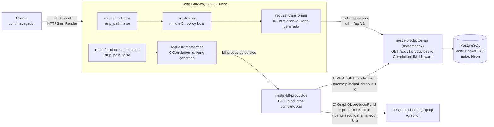

# Práctica 9 · Kong Gateway enrutando microservicios NestJS (Semana 8)

Integración de Sistemas (PUCE) · Autor: **Anthony Rosero** (trabajo individual)

[](https://github.com/ajrm18/kong-gateway-practica-9/actions/workflows/ci.yml)

## Objetivo

Poner **Kong Gateway 3.6 en modo DB-less** (configuración declarativa en YAML) delante de la API de Productos, aplicar **rate-limiting** real (5 peticiones por minuto → 429), propagar un encabezado de trazabilidad **`X-Correlation-Id`** hasta el backend y resolver el reto: un **Aggregator/BFF** (`nestjs-bff-productos`) que combina la API REST con la API GraphQL. Todo queda desplegado en Render.

> La **API de Productos no vive en este repositorio**: es el proyecto de las prácticas anteriores, repo [`ajrm18/apisemana2`](https://github.com/ajrm18/apisemana2). En esta práctica solo se le agregó el log de `X-Correlation-Id` (commit `feat: log de X-Correlation-Id para Kong (Semana 8)`, archivo `src/common/correlation-id.middleware.ts`).

## Links públicos

| Qué | URL |
|---|---|
| Repositorio | https://github.com/ajrm18/kong-gateway-practica-9 |
| Kong → API de Productos | https://kong-gateway-p9.onrender.com/productos · https://kong-gateway-p9.onrender.com/productos/3 (en Neon no existe el id 1: `/productos/1` → 404) |
| Kong → BFF | https://kong-gateway-p9.onrender.com/productos-completos/3 |
| Kong (health check) | https://kong-gateway-p9.onrender.com/kong-health |
| BFF directo (`/health`) | https://bff-productos-p9.onrender.com/health |
| Swagger de la API de Productos | https://apisemana2.onrender.com/api/docs |
| Estado del CI | https://github.com/ajrm18/kong-gateway-practica-9/actions/workflows/ci.yml |

> **Render Free duerme los servicios tras 15 minutos sin tráfico.** Antes de la demo hay que abrir, en este orden, https://apisemana2.onrender.com/api/v1/health, https://bff-productos-p9.onrender.com/health y https://kong-gateway-p9.onrender.com/kong-health, y esperar a que respondan (puede tardar 1 minuto cada uno). El BFF usa un timeout de 8 s por fuente: si la API REST todavía está despertando, la primera llamada a `/productos-completos/:id` puede devolver 502; la segunda ya responde.

## Arquitectura



## Estructura

```
kong-gateway-practica-9/
  .github/workflows/ci.yml       CI: BFF (npm ci, lint, build, test, e2e) + Kong (config parse y prueba real del 429)
  nestjs-bff-productos/          Reto Aggregator/BFF (NestJS 12, CommonJS, Jest)
  kong-gateway/
    docker-compose.yml           Kong local (8000 proxy, 127.0.0.1:8001 Admin API)
    kong.yml                     Configuración local (host.docker.internal)
    kong.cloud.yml               Configuración de nube (URLs de Render, read_timeout 90 s)
    Dockerfile                   FROM kong:3.6 + kong.cloud.yml
  scripts/
    probar-rate-limit.sh / .ps1  Prueba del 429 contra cualquier URL base
    graphql-simulado.js          GraphQL de prueba local (ver "Hallazgos del entorno")
  docs/evidencia/                Salidas reales de cada paso
  render.yaml                    Blueprint: bff-productos-p9 + kong-gateway-p9
  BITACORA.md
```

## Cómo levantar todo en local

Requisitos: Docker Desktop, Node 24+ y la API de Productos clonada aparte (`ajrm18/apisemana2`).

```bash
# 1) API de Productos (repo apisemana2) con su PostgreSQL en Docker (puerto 5433)
docker start pg-productos
cd nestjs-productos-api && npm install && npm run start:dev      # http://localhost:3000/api/v1/productos

# 2) BFF (este repo)
cd nestjs-bff-productos && cp .env.example .env && npm ci && npm run start:dev   # http://localhost:3001/health

# 3) Kong
cd kong-gateway && docker compose up -d
curl http://localhost:8001/status
```

Cada cambio de `kong.yml` se valida antes de reiniciar:

```bash
docker compose exec kong kong config parse /kong/kong.yml
docker compose restart kong
```

> En Git Bash hay que anteponer `MSYS_NO_PATHCONV=1` a los comandos `docker ... /kong/kong.yml`; si no, Git Bash convierte la ruta en `C:/Program Files/Git/kong/kong.yml`.

## Comandos de prueba (bash y PowerShell)

En PowerShell `curl` es un alias de `Invoke-WebRequest`, y `for i in ...` es sintaxis de bash. Por eso se usa `curl.exe`.

| Prueba | Bash (Git Bash / Linux) | PowerShell |
|---|---|---|
| Directo a la API | `curl -i http://localhost:3000/api/v1/productos` | `curl.exe -i http://localhost:3000/api/v1/productos` |
| Vía Kong | `curl -i http://localhost:8000/productos/1` | `curl.exe -i http://localhost:8000/productos/1` |
| 6 peticiones (429 en la 6.ª) | `for i in 1 2 3 4 5 6; do curl -s -o /dev/null -w "%{http_code}\n" http://localhost:8000/productos; done` | ``1..6 \| % { curl.exe -s -o NUL -w "%{http_code}`n" http://localhost:8000/productos }`` |
| Script del rate-limit | `./scripts/probar-rate-limit.sh http://localhost:8000` | `.\scripts\probar-rate-limit.ps1 -BaseUrl http://localhost:8000` |
| Script en la nube | `./scripts/probar-rate-limit.sh https://kong-gateway-p9.onrender.com` | `.\scripts\probar-rate-limit.ps1 -BaseUrl https://kong-gateway-p9.onrender.com` (agregar `-SslNoRevoke` si `curl.exe` falla con `CRYPT_E_NO_REVOCATION_CHECK`, por ejemplo con Kaspersky) |
| BFF vía Kong | `curl -s http://localhost:8000/productos-completos/1` | `curl.exe -s http://localhost:8000/productos-completos/1` |
| Con y sin Gateway | `docker compose stop kong` → 3000 responde, 8000 falla → `docker compose start kong` | igual |

## Evidencias (`docs/evidencia/`)

| Paso de la guía | Archivo | Qué muestra |
|---|---|---|
| 0 · API corriendo | `paso0.txt` | `GET /api/v1/productos` → 200 |
| 1 · Kong DB-less | `paso1.txt` | `docker compose ps` y `GET :8001/status` |
| 2-3 · YAML literal de la guía | `paso3-guia-literal.txt` | `strip_path: true` → la API recibe `GET /` y `GET /1` → 404 |
| 2-3 · Service y Route corregidos | `paso3.txt` | Mismo JSON directo y vía Kong, `Via`, `X-Kong-Upstream-Latency`, `X-Kong-Proxy-Latency`, `/services` y `/routes` |
| 4 · Rate-limiting | `paso4-rate-limit.txt` | 200 ×5 y **429** en la 6.ª con `API rate limit exceeded`, `X-RateLimit-*`, `RateLimit-Reset`, `Retry-After` (bash y PowerShell) |
| 5 · X-Correlation-Id | `paso5-correlation.txt` | `curl -v` vía Kong y directo; log de Nest con `kong-generado` y `(sin header)` |
| 6 · Con y sin Gateway | `paso6.txt` | Kong detenido: 3000 → 200, 8000 → `Failed to connect` |
| 7 · Aggregator/BFF | `paso7-bff.txt` | Kong elige `/productos-completos`; 200 combinado, 400, 404, 502, GraphQL caído, `X-Correlation-Id` hasta REST y GraphQL |
| Latencia | `latencia-crudo.txt` | 20 peticiones directas y 20 vía Kong (datos de la bitácora) |
| Nube | `nube.txt` | Mismas pruebas contra la URL pública de Kong: 200, 404, BFF, Admin API cerrada, **429**, intento de falsificar `X-Forwarded-For` y bypass directo |
| Nube (diagnóstico) | `nube-diagnostico-ip.txt` | Por qué con `X-Forwarded-For` no salía el 429 en Render y por qué se usa `CF-Connecting-IP` |

## Errores de la guía corregidos

| # | Error | Evidencia | Corrección |
|---|---|---|---|
| 1 | `strip_path` es `true` por defecto: con `paths: ["/productos"]` Kong reenvía `/productos` como `/`. Además la API vive en `/api/v1/productos` (`setGlobalPrefix('api/v1')`) | `paso3-guia-literal.txt`: `Cannot GET /` y `Cannot GET /1` | `url: http://host.docker.internal:3000/api/v1` y `strip_path: false` (`kong-gateway/kong.yml`) |
| 2 | Paso 7: la route `/productos-completos` tiene el mismo problema y el BFF llama a `http://localhost:3000/productos/${id}` (sin `/api/v1`, URL fija) | `paso7-bff.txt` | `strip_path: false`; el BFF usa `PRODUCTOS_API_URL` y `GRAPHQL_URL` (`src/config/bff.config.ts`), obligatoria en producción |
| 3 | `curl` en PowerShell es `Invoke-WebRequest` y `for i in ...` es bash | — | Comandos con `curl.exe` y scripts `.sh` y `.ps1` (tabla anterior) |
| 4 | `version: "3.8"` en `docker-compose.yml` es obsoleto (advertencia de Compose) | — | Se quitó la clave |
| 5 | `X-Correlation-Id: kong-generado` es un valor fijo, no un id por petición | `paso5-correlation.txt` | Se implementó tal cual (es lo evaluado). Mejora opcional abajo |

### Mejora opcional (no activada): plugin `correlation-id`

El valor fijo no permite distinguir una petición de otra, y `request-transformer` con `add` no reemplaza un header que el cliente ya envió (`paso5-correlation.txt`, punto 3). Kong trae un plugin para esto:

```yaml
    plugins:
      - name: correlation-id
        config:
          header_name: X-Correlation-Id
          generator: uuid          # un UUID distinto por petición
          echo_downstream: true    # lo devuelve también al cliente
```

## Desviaciones y decisiones

- **Prefijo `/api/v1` y `strip_path: false`** en las dos routes (errores 1 y 2).
- **Admin API solo en local:** `127.0.0.1:8001:8001` en Compose; en Render `KONG_ADMIN_LISTEN=off`.
- **`request-transformer` también en el service del BFF**: sin él, el BFF no recibe `X-Correlation-Id` por `/productos-completos` y no puede demostrar la propagación hasta REST y GraphQL.
- **Orden REST → GraphQL en el BFF:** la query GraphQL necesita el precio que devuelve REST (`productosBaratos(precioMaximo: <precio REST>)`), así que no puede salir en paralelo con REST. Lo que sí va en paralelo son los dos campos de la única query (`productoPorId` y `productosBaratos`), que el servidor GraphQL resuelve a la vez, y el resultado se evalúa con `Promise.allSettled`: un fallo de GraphQL nunca anula la respuesta.
- **`KONG_REAL_IP_HEADER=CF-Connecting-IP` en lugar de `X-Forwarded-For`** (Render): con `X-Forwarded-For` el rate-limit **no funcionaba en la nube** (`X-RateLimit-Remaining-Minute` siempre en 4, sin 429). Render pasa por Cloudflare y el header llega como `cliente, IP de Cloudflare, 10.24.x.x`; Nginx toma la última, que es un proxy interno distinto en cada petición. `CF-Connecting-IP` lo fija Cloudflare con la IP real y rechaza con 403 a un cliente que intente enviarlo (`docs/evidencia/nube.txt`).
- **`/kong-health`** solo en `kong.cloud.yml`: route con `request-termination` para el health check de Render (no pasa por el rate-limit ni despierta otros servicios).
- **Sin `tls_verify` hacia los upstream de Render**: se probó `tls_verify: true` con la CA del sistema y Kong 3.6 OSS responde 502 (`upstream SSL certificate verify error: (20:unable to get local issuer certificate)`) porque necesita una entidad `ca_certificates` explícita. Se dejó el valor por defecto de Kong (TLS cifrado sin verificar el certificado del upstream); ver la auditoría.
- **CommonJS + Jest con `--experimental-vm-modules`**: Nest 12 genera proyectos ESM con Vitest; se convirtió a CommonJS con Jest, como `apisemana2`.

## Hallazgos del entorno

- **La API GraphQL pública no entrega datos.** Su resolver tiene fija la URL `https://nestjs-productos-api.onrender.com/api/v1/productos`, y hoy responde `{"data": null, "errors": [{"message": "Request failed with status code 429"}, ...]}`. El BFF lo trata como fuente caída: responde con los datos REST y `fuentes.graphql: "no-disponible"`. Ese repo no se modificó. Para mostrar el camino `graphql: "ok"` se usó `scripts/graphql-simulado.js` en local (`paso7-bff.txt`, punto 3).
- **En la nube no existe el producto 1**: la base Neon de `apisemana2` tiene los ids 3, 4 y 5. `GET /productos/1` responde 404 en Render (correcto) y la demo usa el id 3.

## CI/CD

- **CI** (`.github/workflows/ci.yml`), en cada push y PR a `main`:
  - `bff`: `npm ci`, `npm run lint` (`--deny-warnings`), `npm run build`, `npm test`, `npm run test:e2e`, `npm audit --omit=dev --audit-level=high` (Node 24).
  - `kong`: `kong config parse` de `kong.yml` y `kong.cloud.yml` con `kong:3.6`; levanta Kong con Compose delante de una API simulada y ejecuta `probar-rate-limit.sh` (debe salir el 429).
- **CD**: `render.yaml` con `autoDeployTrigger: checksPass`: Render despliega solo si el CI está en verde.

## Declaración de uso de IA

Ver `BITACORA.md`.
